# Assignment 03 — Deploy a Static Website to Multiple Servers Using a Multi-Play Ansible Playbook

Part of the DevOps Micro Internship (DMI) with Agentic AI

---

## Student Details

**Full Name:** Saima Usman \
**Cloud Platform Used:** Azure  \
**Server 1 URL:** `http://20.41.219.19`  
**Server 2 URL:** `http://104.211.227.39`

---

## Purpose

In this assignment, you will create a multi-play Ansible playbook to install Nginx, deploy a static website to two Ubuntu servers, and verify that the website is accessible from both servers.

You may use either AWS EC2 instances or Azure Virtual Machines as your managed servers.

---

# Task 1 — Create the Project Structure

## Goal

Create the required folders and files for the Ansible project.

## Evidence

### Screenshot 1 — Terminal or VS Code showing the complete `static-web` project structure

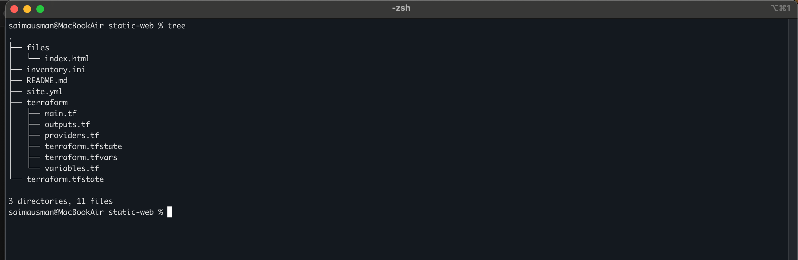


---

# Task 2 — Configure the Ansible Inventory

## Goal

Add both Ubuntu servers to the Ansible inventory.

## Evidence

### Screenshot 2 — Output of `ansible-inventory -i inventory.ini --graph` showing `web1` and `web2`

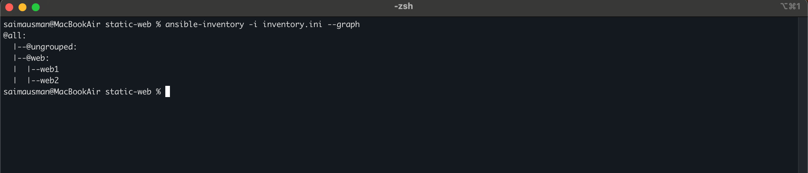


---

## Configuration File

Copy and paste the complete contents of your `inventory.ini` file below:

```ini
[web]
web1 ansible_host=20.41.219.19
web2 ansible_host=104.211.227.39

[web:vars]
ansible_user=azureuser
ansible_ssh_private_key_file=/Users/saimausman/.ssh/azure-ansible
```

---

# Task 3 — Verify Ansible Connectivity

## Goal

Confirm that the Ansible controller can connect to both servers.

## Evidence

### Screenshot 3 — Ansible ping output showing `SUCCESS` and `pong` for both servers

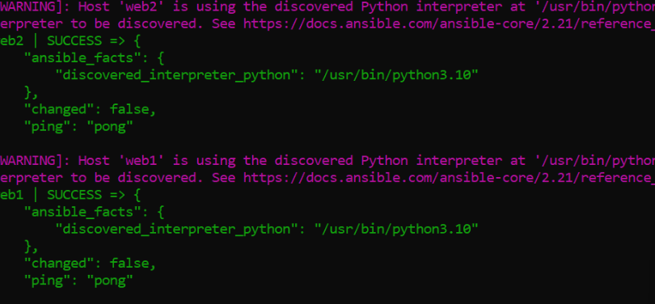

---

# Task 4 — Download and Personalize the Static Website

## Goal

Download `index.html` to the Ansible controller and personalize the website with your full name.

## Evidence

### Screenshot 4 — Edited `files/index.html` showing the footer line with your full name

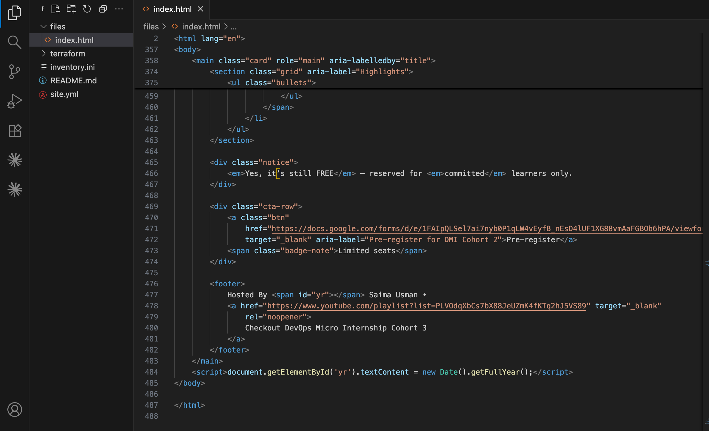

---

# Task 5 — Create the Multi-Play Ansible Playbook

## Goal

Create a single Ansible playbook containing separate plays for installation, deployment, and verification.

## Configuration File

Copy and paste the complete contents of your `site.yml` file below:

```yaml
---
- name: Install and configure Nginx
  hosts: web
  become: true

  tasks:
    - name: Update the APT package cache
      ansible.builtin.apt:
        update_cache: true

    - name: Install Nginx
      ansible.builtin.apt:
        name: nginx
        state: present

    - name: Start and enable Nginx
      ansible.builtin.service:
        name: nginx
        state: started
        enabled: true


- name: Deploy the static website
  hosts: web
  become: true

  tasks:
    - name: Copy index.html to the web root
      ansible.builtin.copy:
        src: files/index.html
        dest: /var/www/html/index.html
        owner: www-data
        group: www-data
        mode: "0644"
      notify: Reload nginx

  handlers:
    - name: Reload nginx
      ansible.builtin.service:
        name: nginx
        state: reloaded


- name: Verify both websites from the controller
  hosts: localhost
  connection: local
  gather_facts: false
  become: false

  tasks:
    - name: Send an HTTP GET request to each web server
      ansible.builtin.uri:
        url: "http://{{ hostvars[item].ansible_host }}"
        status_code: 200
      loop: "{{ groups['web'] }}"
      register: website_checks

    - name: Confirm each server returned HTTP 200
      ansible.builtin.assert:
        that:
          - item.status == 200
        success_msg: "{{ item.item }} returned HTTP {{ item.status }}"
        fail_msg: "{{ item.item }} did not return HTTP 200"
      loop: "{{ website_checks.results }}"
```

---

# Task 6 — Validate the Playbook Syntax

## Goal

Check the playbook for YAML or Ansible syntax errors before running it.

## Evidence

### Screenshot 5 — Successful syntax-check output showing `playbook: site.yml`

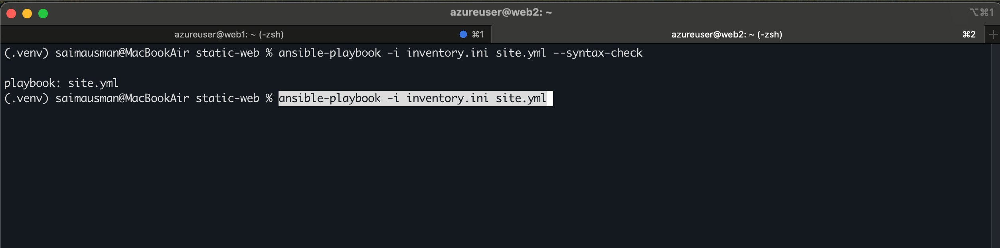

---

# Task 7 — Run the Multi-Play Playbook

## Goal

Install Nginx, deploy the website, and verify both servers in one playbook run.

## Evidence

### Screenshot 6 — Play 3 verification showing HTTP `200` for both servers

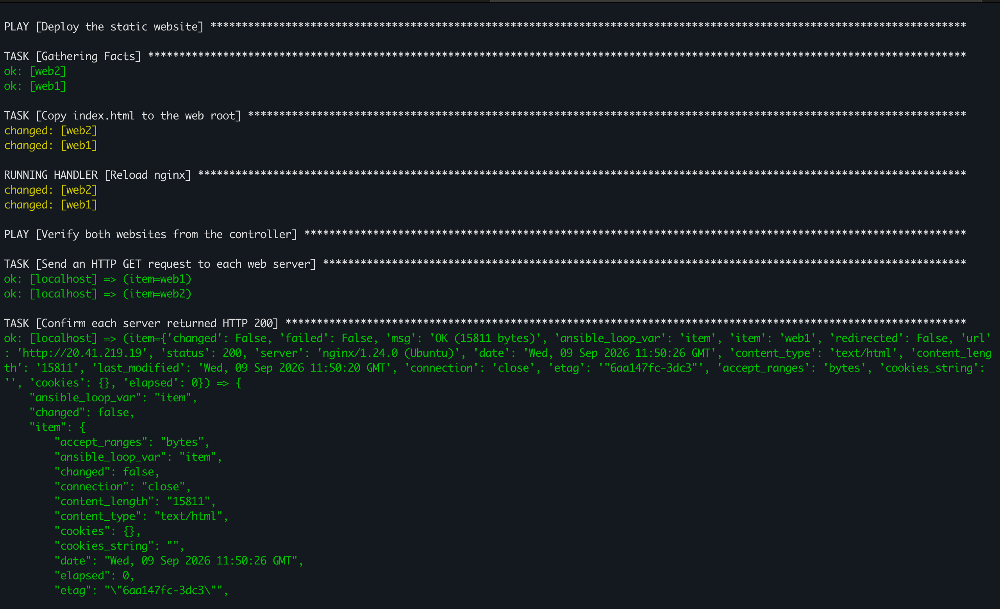

---

### Screenshot 7 — Final play recap showing `unreachable=0` and `failed=0` for `web1`, `web2`, and `localhost`

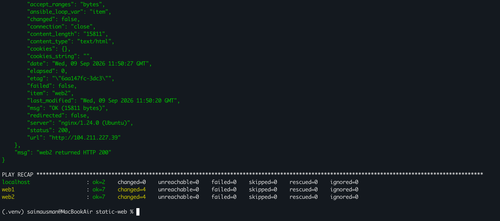

---

# Task 8 — Verify Idempotency

## Goal

Run the playbook again and confirm that it does not make unnecessary changes.

## Evidence

### Screenshot 8 — Second playbook run showing the play recap with `changed=0`, `unreachable=0`, and `failed=0` for both web servers

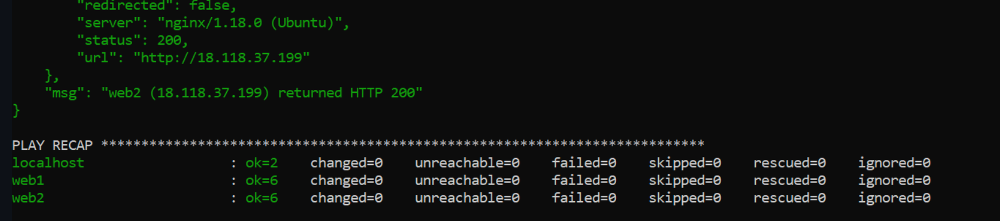

---

# Task 9 — Test Both Websites Manually

## Goal

Confirm that the static website is accessible from both public IP addresses.

## Evidence

### Screenshot 9 — `curl -I` output showing HTTP `200 OK` from both servers

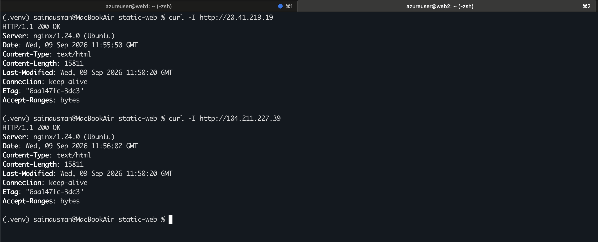

---

### Screenshot 10 — Browser showing the website from Server 1 with the public IP and your full name visible

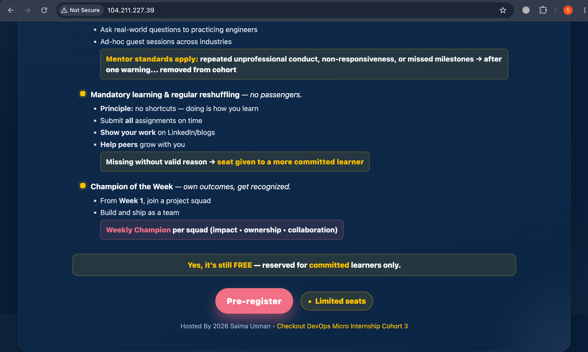

---

### Screenshot 11 — Browser showing the website from Server 2 with the public IP and your full name visible


**[Web1 Server]**

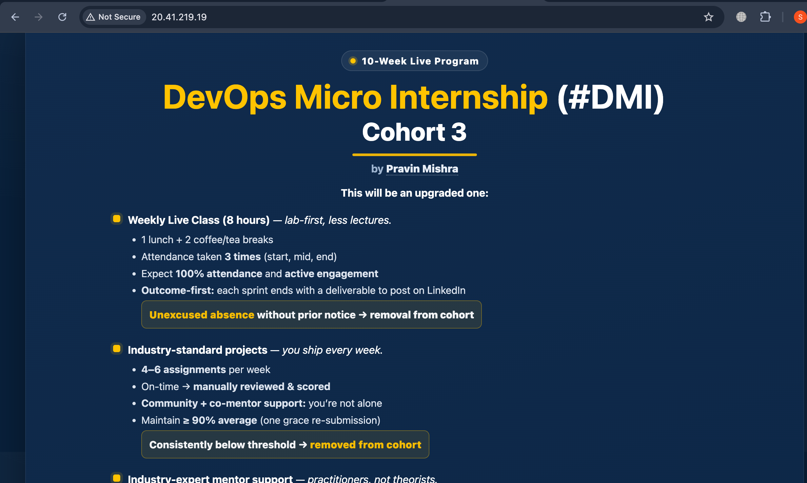

**[Web2 Server]**

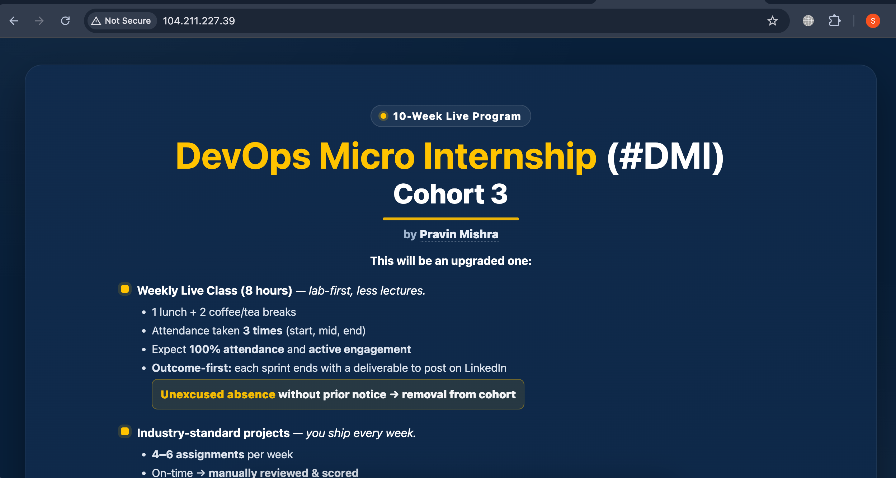

---

## Website URLs

Add both deployed website URLs below:

```text
Server 1: http://20.41.219.19
Server 2: http://104.211.227.39
```

---

# Task 10 — Complete the Project README

## Goal

Document how the project works and record what you learned.

## README Content

Copy and paste the complete contents of your `README.md` file below:

```markdown
# Multi-Play Web Deployment on Azure with Ansible

Automate Nginx installation, static website deployment, and HTTP verification across Azure Ubuntu virtual machines using one Ansible playbook with three plays.

**Author:** Saima Usman  
**Program:** DevOps Micro Internship (DMI), Cohort 3 — Agentic AI Track  
**Assignment:** Week 09 · Assignment 03

## Overview

This project demonstrates how Ansible manages multiple web servers from a single controller. Azure infrastructure is provisioned using Terraform, and Ansible configures the existing hosts in the `[web]` inventory group.

The deployment follows three stages:

1. Install Nginx and ensure the service is started and enabled.
2. Copy the locally staged website to each web server and notify an Nginx reload handler when the content changes.
3. Verify every web server from the controller using the `uri` module and assert an HTTP `200` response.

The assignment submission records successful deployment and subsequent content updates on **web1** and **web2**, with browser screenshots and controller-side verification evidence.

## Technology Stack

| Tool | Purpose |
| --- | --- |
| Microsoft Azure | Host the Ubuntu web servers |
| Terraform | Provision the Azure infrastructure |
| Ansible | Configure hosts, deploy content, and verify HTTP responses |
| Nginx | Serve the static website |
| Ubuntu Linux | Operating system on the managed hosts |
| SSH | Connect the controller to the managed hosts |
| HTML | Static website content |

## Deployment Design

| Component | Responsibility |
| --- | --- |
| Ansible controller | Store the inventory, playbook, and website source; run automation |
| `web1` and `web2` | Run Nginx and serve the deployed website |
| Azure Network Security Group | Permit the required SSH and HTTP traffic |
| Localhost verification play | Check each web server over HTTP from the controller |

The controller connects to each web host over SSH for configuration. Website verification uses HTTP on port `80`.

## Project Structure

The assignment uses this project layout:

static-web/
├── inventory.ini
├── site.yml
├── files/
│   └── index.html
└── README.md

> This README documents the assignment workflow. The inventory example below is a template; use your actual VM details and existing `site.yml`.

## Prerequisites

- An Ansible controller with Ansible installed.
- Existing Azure Ubuntu VMs provisioned for the lab.
- Public IP addresses or other controller-reachable addresses for the web servers.
- A valid SSH username and private key for those VMs.
- SSH access on port `22` from the controller, restricted to its public IP where applicable.
- HTTP access on port `80` from the controller and the browser used for verification.
- A remote user with the required `sudo` privileges.
- The website's `index.html` staged locally in `files/`.

Check the controller installation:

ansible --version
ansible-playbook --version

## Configure the Inventory

Create or update `inventory.ini` in `static-web/`:


[web]
web1 ansible_host=<WEB1_PUBLIC_IP>
web2 ansible_host=<WEB2_PUBLIC_IP>

[web:vars]
ansible_user=<AZURE_VM_USERNAME>
ansible_ssh_private_key_file=/absolute/path/to/your/private-key
ansible_python_interpreter=/usr/bin/python3

Replace every placeholder before running the commands. Keep the private key outside the repository.

Validate the groups and SSH connectivity:


cd static-web
ansible-inventory -i inventory.ini --graph
ansible web -i inventory.ini -m ping


Ansible's `ping` module checks Ansible connectivity and remote Python execution; it is not an ICMP network ping.

## Stage the Website

Download or copy `index.html` from the [Azure Static Website source repository](https://github.com/pravinmishraaws/Azure-Static-Website) into:


static-web/files/index.html


Review the local file before deployment. If you customize the page to reference additional assets, deploy those assets too; the assignment's specified copy task deploys `index.html`.

## Playbook Workflow

### Play 1 — Install and Start Nginx

Target the `web` group and use privilege escalation to:

- Refresh the APT package cache and install Nginx.
- Start the Nginx service.
- Enable Nginx at boot.

### Play 2 — Deploy the Website

Use `ansible.builtin.copy` to deploy the controller's local HTML file:

| Setting | Value |
| --- | --- |
| Source | `files/index.html` |
| Destination | `/var/www/html/index.html` |
| Owner | `www-data` |
| File mode | `'0644'` |
| Notification | Nginx reload handler |

The handler runs when the copy task reports a change. Keeping installation and deployment in separate plays makes each stage easier to understand, maintain, and troubleshoot.

### Play 3 — Verify from the Controller

Run the verification play on `localhost` and loop over every host in `groups['web']`.

For each host, the playbook should:

- Build the HTTP URL using its `ansible_host` address.
- Request the page using `ansible.builtin.uri`.
- Require HTTP status `200`.
- Assert that the returned status is `200` for each result.

Controller-side verification confirms that the site is reachable from outside the managed VM, along the controller's network path.

## Run the Deployment

From `static-web/`, validate playbook syntax:


ansible-playbook -i inventory.ini site.yml --syntax-check


Run the three-play deployment:


ansible-playbook -i inventory.ini site.yml


If the remote sudo configuration requires a password, add `--ask-become-pass` to the deployment command. The installation and deployment plays must use `become: true`, or receive equivalent privilege escalation through the command line.

### Expected Outcome

- Nginx is installed, running, and enabled on both web servers.
- The website is present at `/var/www/html/index.html` with the specified ownership and permissions.
- The Nginx reload handler runs when deployed content changes.
- Controller-side HTTP checks return `200` for every web host.
- The play recap reports `failed=0` and `unreachable=0`.

## Verify Manually

Replace the address placeholders and test both web servers:


curl -I http://20.41.219.19
curl -I http://104.211.227.39


Open each address in a browser:


http://20.41.219.19 

http://104.211.227.39


Confirm the custom website is displayed on both hosts. An HTTP `200` response confirms a successful request; checking the page content also confirms that the intended website was deployed.

## Update the Website

1. Edit `files/index.html` on the controller.
2. Run the same playbook again:

   
   ansible-playbook -i inventory.ini site.yml
   

3. Refresh both web-server pages and confirm the updated content.

A single invocation targets both servers. Task execution depends on Ansible's configured strategy and concurrency; updates are not guaranteed to occur at exactly the same instant.

Ansible modules such as `apt`, `copy`, and `service` support idempotent configuration. Repeating a run with unchanged inputs should avoid unnecessary changes for those tasks, although cache refreshes and other playbook details can affect the recap.

## Troubleshooting and Lessons Learned

| Issue recorded in the assignment | Resolution |
| --- | --- |
| SSH connectivity and inventory configuration | Verified public IPs, the SSH key path, the VM username, and NSG access rules |
| VM size or quota unavailable in an Azure region | Selected a region with suitable VM capacity and quota |

Key lessons:

- Terraform provisions the infrastructure; Ansible configures the existing servers.
- Separate plays give installation, deployment, and verification clear responsibilities.
- The `copy` module deploys the exact locally staged file consistently across hosts.
- Managed servers do not need Git or direct repository access when the controller distributes the content.
- Handlers make service actions conditional on configuration or content changes.
- Automated checks and browser verification provide complementary deployment evidence.

## Assignment Evidence

The [assignment submission](https://github.com/Saima-Devops/devops-micro-internship-pravinmishra/blob/main/week-09-ansible/assignment-03-multi-play-web-deploy-on-azure.md) contains screenshots showing:

- The project structure and locally staged website.
- The three-play `site.yml`, copy settings, handler, and HTTP assertion.
- A successful playbook run and localhost verification.
- The website loaded in a browser.
- Updated website content on both web servers after another playbook run.

## Security Notes

- Never commit SSH private keys, passwords, or cloud credentials.
- Restrict SSH access to the controller's trusted IP address.
- Redact public IP addresses in shared inventory examples or screenshots when appropriate.
- Keep SSH host-key verification enabled and verify newly encountered hosts.
- This lab uses HTTP for verification; a public production deployment should also configure HTTPS.

## References

- [Assignment 03 — Multi-Play Web Deploy on Azure](https://github.com/Saima-Devops/devops-micro-internship-pravinmishra/blob/main/week-09-ansible/assignment-03-multi-play-web-deploy-on-azure.md)
- [Website Source — Azure Static Website](https://github.com/pravinmishraaws/Azure-Static-Website)
- [DMI Repository — Saima-Devops](https://github.com/Saima-Devops/devops-micro-internship-pravinmishra)
```

---

## Author

**Saima Usman**  
Certified DevOps & MultiCloud Engineer

Completed as part of **DevOps Micro Internship (DMI), Cohort 3 — Agentic AI Track**, led by **Pravin Mishra and The CloudAdvisory team**.


# LinkedIn Post Required

## Evidence

### LinkedIn Post URL

https://www.linkedin.com/posts/saima-usman_devops-ansible-azure-share-7517988105581121536-qzYR

---

### Screenshot — Published LinkedIn post

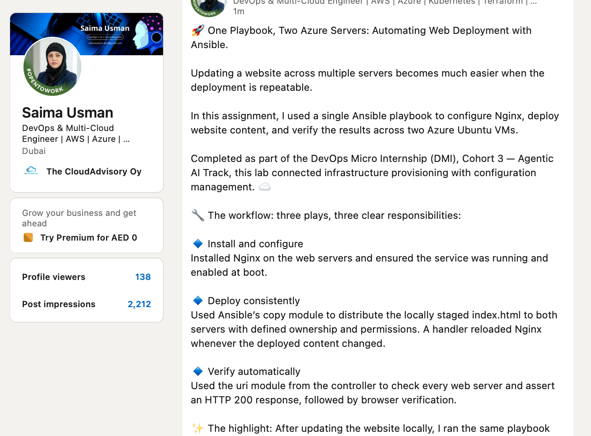

---

# Assignment Questions

Answer the following in your own words:

**1. What issue did you face while completing this assignment, and how did you fix it?**

I initially faced issues with SSH connectivity and inventory configuration while setting up the Azure servers. I also had to search through different Azure regions to find a suitable region with the required VM size and available quota. I fixed these issues by verifying the public IP addresses, SSH key path, username, and ensuring that the required ports were allowed in the Azure Network Security Group. I also selected a region where the required VM quota was available.

---

**2. What did you learn from this assignment?**

I learned how to use Ansible to automate the configuration and deployment of a website across multiple AWS EC2 servers.

I learned how to create an inventory, test server connectivity, install and configure Nginx, deploy files using the copy module, use handlers, and automatically verify the website using the uri module.

I also learned the importance of idempotency. A good automation script should be safe to run multiple times without making unnecessary changes.

Most importantly, I gained practical experience troubleshooting SSH authentication and understanding how separate stages of an automated deployment can work together.

---

**3. Why is it useful to split installation, deployment, and verification into separate plays?**

Splitting installation, deployment, and verification into separate plays makes the playbook easier to understand, maintain, and troubleshoot.

The installation play prepares the servers by installing and configuring Nginx. The deployment play manages the website content, while the verification play checks from the Ansible controller that the websites are actually responding correctly.

Each play therefore has a clear responsibility. If something goes wrong, it is easier to identify which stage of the deployment caused the problem.

It also makes the automation easier to extend or modify in the future.

---

**4. What is one benefit of using the Ansible `copy` module instead of cloning the website directly from Git on every managed server?**

One major benefit is simplicity.

The copy module allows the website file to be transferred directly from the Ansible controller to the managed servers without requiring Git to be installed or the repository to be cloned on every server.

It is also idempotent because Ansible can detect whether the destination file already contains the correct content and avoid making an unnecessary change.

For this assignment, using copy was appropriate because the deployment involved a static `index.html` file.

---

**5. What does idempotency mean in this assignment?**

Idempotency means that running the same Ansible playbook multiple times produces the same desired state without making unnecessary changes.

In this assignment, after the website and Nginx configuration were already correct, I ran the playbook again.

The final recap showed:

web1 changed=0

and

web2 changed=0

This demonstrated that Ansible recognized that the servers were already in the desired state and did not make unnecessary changes.

Idempotency is important because DevOps automation should be safe and predictable to run repeatedly.

---

**6. What does the Ansible `uri` module verify in Play 3?**

The Ansible uri module in Play 3 verifies that the deployed websites are accessible over HTTP from the Ansible controller.

It sends HTTP requests to both web servers and checks that they return an HTTP status code of 200.

In this assignment, Play 3 successfully verified:

web1 (13.58.177.204) returned HTTP 200 web2 (18.118.37.199) returned HTTP 200

This provides automated evidence that the Nginx web servers are running and that the deployed websites are accessible.

---

# Required Files

Confirm that the following files are included in your assignment folder:

- [ ] `inventory.ini`
- [ ] `site.yml`
- [ ] `files/index.html`
- [ ] `README.md`

---

# Submission Instructions

- Add all required screenshots in the correct order.
- Full Name must be visible in required screenshots.
- Include both deployed website URLs.
- Paste `inventory.ini`, `site.yml`, and `README.md` as editable text.
- Answer all assignment questions clearly in your own words.
- Add your LinkedIn post URL.
- Do not expose SSH private keys, passwords, cloud account IDs, or other sensitive information.

---

# Completion Checklist

- [ ] Task 1: `static-web` folder structure is complete
- [ ] Task 2: Both servers are listed under the `[web]` group in `inventory.ini`
- [ ] Task 2: Inventory graph shows `web1` and `web2`
- [ ] Task 3: Ansible ping returns `SUCCESS` and `pong` for both servers
- [ ] Task 4: `files/index.html` contains your full name
- [ ] Task 5: `site.yml` contains three separate plays
- [ ] Task 5: Play 1 installs, starts, and enables Nginx
- [ ] Task 5: Play 2 deploys `index.html` using the `copy` module
- [ ] Task 5: Nginx reload handler is included
- [ ] Task 5: Play 3 verifies both web servers from the controller
- [ ] Task 6: Playbook syntax check passes
- [ ] Task 7: First playbook run completes with `unreachable=0` and `failed=0`
- [ ] Task 7: URI verification returns HTTP `200` for both servers
- [ ] Task 8: Second playbook run demonstrates idempotency
- [ ] Task 8: Second run shows `changed=0` for both web servers
- [ ] Task 9: Both `curl -I` commands return HTTP `200 OK`
- [ ] Task 9: Website loads from Server 1
- [ ] Task 9: Website loads from Server 2
- [ ] Task 9: Full name is visible on both deployed websites
- [ ] Task 10: `README.md` contains all required explanations
- [ ] Screenshots 1–11 are included
- [ ] `inventory.ini`, `site.yml`, and `README.md` are pasted as editable text
- [ ] Both website URLs are included
- [ ] Assignment questions are answered
- [ ] LinkedIn post published
- [ ] LinkedIn post URL added
- [ ] No sensitive information is exposed

---

## About DMI & CloudAdvisory

DevOps Micro Internship (DMI) is a project-based DevOps program run by Pravin Mishra and The CloudAdvisory, focused on real-world execution, systems thinking, and career readiness.

It helps learners build strong DevOps foundations with hands-on experience.

---

## Resources

- DMI Official Website: [https://dmi.pravinmishra.com?utm_source=github&utm_medium=readme](https://dmi.pravinmishra.com?utm_source=github&utm_medium=readme)
- University: [https://university.pravinmishra.com?utm_source=github&utm_medium=readme](https://university.pravinmishra.com?utm_source=github&utm_medium=readme)
- Discord Community: [https://discord.pravinmishra.com?utm_source=github&utm_medium=readme](https://discord.pravinmishra.com?utm_source=github&utm_medium=readme)
- Blog: [https://dmi.pravinmishra.com/blog?utm_source=github&utm_medium=readme](https://dmi.pravinmishra.com/blog?utm_source=github&utm_medium=readme)
- YouTube Playlist: [https://www.youtube.com/playlist?list=PLFeSNDtI4Cho](https://www.youtube.com/playlist?list=PLFeSNDtI4Cho)
- Pravin Mishra LinkedIn: [https://www.linkedin.com/in/pravin-mishra-aws-trainer/](https://www.linkedin.com/in/pravin-mishra-aws-trainer/)
- CloudAdvisory LinkedIn: [https://www.linkedin.com/company/thecloudadvisory/](https://www.linkedin.com/company/thecloudadvisory/)

---

*This submission is part of DevOps Micro Internship (DMI) — Agentic AI Track.*